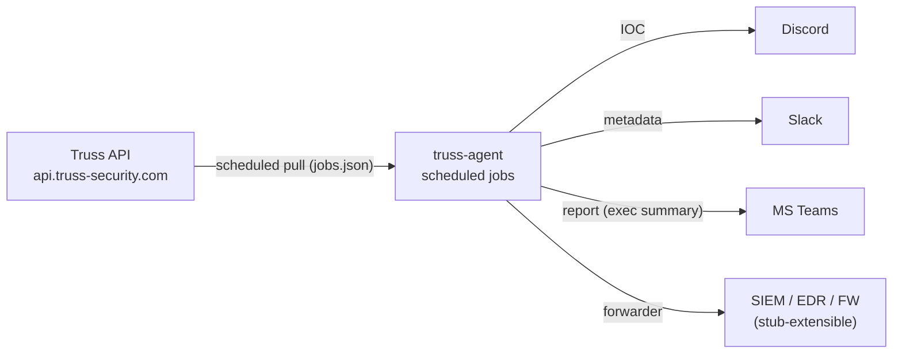

# Truss Agent — pull cybersecurity indicators from the Truss API and fan out to Discord/Slack/MS Teams/SIEM

A service that runs scheduled jobs against the **Truss API** (`https://api.truss-security.com`) and posts results to your chosen destinations. Discord, Slack, and MS Teams are first-class today; SIEM/EDR/FW connectors (e.g. Splunk) are stub-extensible.

## Contents

- [Overview](#overview)
- [Quick Start](#quick-start)
- [Prerequisites](#prerequisites)
- [Configure — Path A: CLI (`npm run config`)](#configure--path-a-cli-npm-run-config)
- [Configure — Path B: Dashboard (no terminal required)](#configure--path-b-dashboard-no-terminal-required)
- [When to use which](#when-to-use-which)
- [Run the service](#run-the-service)
- [Manage connections](#manage-connections)
- [Docker & CI/CD](#docker--cicd)
- [Configuration Reference](#configuration-reference)
- [Troubleshooting](#troubleshooting)
- [CLI Reference (appendix)](#cli-reference-appendix)

## Overview

The agent pulls indicators from the Truss API on a schedule and posts them to the destinations you configure.



What lives where:

- `TRUSS_API_KEY` and `TRUSS_API_URL` — `.env` on the host running the agent.
- Agent display name — `config/agent.json`.
- Destinations (Discord/Slack/MS Teams webhooks + saved Truss queries) — `config/connections.json`.
- Scheduled jobs (cron / interval, output format, lookback) — `config/jobs.json`.

Features:

- Scheduled collection of security indicators from the Truss API
- Three output formats: `ioc`, `metadata` (awareness embeds), `report` (exec summary)
- Discord, Slack, MS Teams destinations out of the box
- Notification system (Discord, email) and Docker support
- Credential-free image: secrets are mounted at runtime, never baked in

## Quick Start

1. **Clone and install** (you must clone the repo first):

```bash
git clone https://github.com/truss-security/truss-agent.git
cd truss-agent
npm install
```

2. **Configure** — pick **one** path:

   - **CLI:** run `npm run config` and follow the **First-Time Setup** walkthrough below.
   - **Dashboard:** open [https://dashboard.truss-security.com/agent](https://dashboard.truss-security.com/agent), build your config in the browser, click **Download ZIP**, then unzip it into the cloned repo so `config/` and `.env` sit next to `package.json`.

3. **Run**:

```bash
docker compose up -d
```

That's it. The agent now runs your configured jobs and posts results to your destinations.

## Prerequisites

- Node.js (v20 or later)
- npm
- A Truss API key (get one from [https://dashboard.truss-security.com](https://dashboard.truss-security.com))
- Docker + Docker Compose if you plan to run the service in a container (recommended for production)

## Configure — Path A: CLI (`npm run config`)

Run the interactive config and complete **First-Time Setup**. This creates `config/agent.json` and `.env` with `TRUSS_API_KEY` (your API key) and defaults: `NODE_ENV=development`, `LOG_LEVEL=info`, `JOBS_FILE=config/jobs.json`. No need to create `.env` manually unless you want to customize it (see [Configuration Reference](#configuration-reference)).

```bash
npm run config
```

Use the menu to complete initial setup (walkthrough below). When you're done, build and run the Docker container so the service runs your scheduled jobs.

### Walkthrough: Initial setup

Follow these steps in order when configuring the agent for the first time.

1. **First-Time Setup**
   Choose **First-Time Setup (agent name, Truss API key)**. Enter your agent name and Truss API key. The name is saved to `config/agent.json`; `.env` is created or updated with `TRUSS_API_KEY` and defaults (`NODE_ENV`, `LOG_LEVEL`, `JOBS_FILE`). You can use **Test Truss API → Destination** in the same session without restarting.

2. **Create New Connection**
   Choose **Create New Connection**. Select a destination type (e.g. Discord). You are prompted **first** for **output format** (IOC only, Metadata, or Report / exec summary). **Report (exec summary)** then asks for a **weekly day** and **24-hour time** (converted to a cron schedule) plus how far back to pull each run. **IOC** and **Metadata** use the same **pull frequency** prompt as before (interval such as `10m`, `1h`, `7d`, plain minutes, or cron). Next you enter connection details (name, webhook URL, etc.). Finally you add a **Truss query**: **Copy in Truss API example** (paste **raw JSON** for `POST /product/search` or a dashboard sample: **curl**, **JavaScript**, **Python**, etc.) or **Manually enter Truss filter options**. If you skip the Truss step, no job is created and the earlier schedule choice is not saved. A completed flow creates a job in `config/jobs.json` and saves the query in `config/connections.json`. (Advanced: `configName` in JSON is still supported if you edit the file by hand.)

3. **Test Destination Connection**
   Choose **Test Destination Connection**. Select a connection (or **None (skip test)** to skip). This only tests the destination (e.g. Discord webhook); no API pull. Use it to confirm the destination is reachable.

4. **Test Truss API → Destination**
   Choose **Test Truss API → Destination**. Select a connection (or **None (skip test)** to skip). This runs the full flow: pull from the Truss API using the connection's query, then send the result to the destination (e.g. Discord). You can choose output format (IOC, Metadata, or Report), preview the payload, and confirm before sending. Works for any connection regardless of enabled/disabled state.

5. **Enable Connections**
   Choose **Enable/Disable Connection**. You'll see a list of all connections with a checkbox (switch) for each: checked = enabled, unchecked = disabled. Toggle with Space, then press Enter and confirm to save. **Enabled** = the job will pull from the Truss API and send to that connection. **Disabled** = the connection is only configured; the job will not run (no pull, no send).

You can also use **List All Connections** anytime to see connections and their enabled/disabled state.

## Configure — Path B: Dashboard (no terminal required)

The Truss dashboard ships an **Agent** page that builds the same `agent.json` / `connections.json` / `jobs.json` / `.env` your CLI would, and packages them as a downloadable ZIP. Use this when you'd rather not run an interactive prompt.

1. Sign in to [https://dashboard.truss-security.com/agent](https://dashboard.truss-security.com/agent).
2. Open the **Setup** card and enter the agent name (and, optionally, your API key — only used during ZIP export, see below).
3. Open the **Connections & jobs** card and add Discord/Slack/MS Teams connections, wire each to a saved Truss filter, and pick an output format and schedule.
4. Open the **Export bundle** card and click **Download ZIP**. If you check **Include live API key inside ZIP**, your key will be embedded in the bundled `.env` (handle the ZIP securely — the dashboard surfaces the same warning).
5. After cloning this repo, **unzip the bundle into the repo root** so that `config/agent.json`, `config/connections.json`, `config/jobs.json`, and `.env` (rename `.env.example` if you didn't embed the key) sit next to `package.json` and `Dockerfile`. The dashboard's bundled `AGENT_EXPORT_README.md` walks through the same merge step.
6. Start the service with `docker compose up -d` (see [Run the service](#run-the-service)).

The same page also has an **Import** card: drag in a previous ZIP, point at the folder that contains `agent.json` / `connections.json` / `jobs.json` (e.g. an existing `config/` folder), or pick the three JSON files individually to keep editing them in the dashboard.

State on the Agent page stays in your browser session only — the dashboard does not store the bundle on Truss servers.

## When to use which

- **CLI (`npm run config`)** — single-host operators who like terminals, want guided prompts, and want to live-test destinations and the full Truss API → destination round-trip on the same machine that will run the agent.
- **Dashboard** — teams who prefer a UI, want to share or version a bundle, or are bootstrapping multiple agents from the same baseline. The output is identical and the two paths can be mixed (e.g. import a CLI-built `config/` folder into the dashboard to edit it, or unzip a dashboard export and continue tweaking with `npm run config`).

## Run the service

Once `config/` and `.env` are in place, choose how to run the agent.

### Docker Compose (recommended)

```bash
docker compose up -d
```

Compose builds the credential-free image, mounts `config/` and loads `.env` from the host, and runs the scheduled job service. See [Docker & CI/CD](#docker--cicd) for restart, rebuild, and registry-push details.

### Long-running scheduler (no Docker)

```bash
npm run cli serve
```

The manager loads jobs from `JOBS_FILE` or `JOBS_JSON` and runs each job on its configured schedule, posting results to the job's destination.

### One-off sync

Run every job once and exit:

```bash
npm run cli sync
```

Run a single job by name:

```bash
npm run cli sync --job "discord-ioc"
```

## Manage connections

Use these `npm run config` menu options to change or remove existing setup.

- **Modify Existing Connection**
  Choose **Modify Existing Connection**, then select the connection. You are asked first whether to **update output format and pull schedule** (same flow as create: Report → weekly day + time + lookback; IOC/Metadata → interval or cron + lookback; defaults from the linked job). Then you edit connection details (name, webhook, enabled, etc.). Then you can **update the Truss API query** (same two choices as create). If you **rename** the connection, linked jobs get `connectionName` and `name` updated. Linked **jobs** stay in sync when you change query and/or schedule.

- **Delete Connection**
  Choose **Delete Connection**, then select the connection. If any job uses it, you are prompted to confirm; on confirm, the connection is removed from `connections.json` and **those jobs are removed from `config/jobs.json`** automatically.

- **Reset All Configuration**
  Choose **Reset All Configuration**. You'll be asked to confirm, then type `reset` to finalize. This clears the agent name, all `.env` values, all connections, and all jobs (factory reset). Use only when you want to start over.

## Docker & CI/CD

The published image is **credential-free**. Both `config/` and `.env` are mounted at runtime — see `.dockerignore` — so the image never contains secrets and is safe to build, push, and run anywhere.

### Docker Compose

On the host where the container runs, ensure `config/` and `.env` exist (run `npm run config` there, drop in a dashboard ZIP, or copy from another host). Then:

```bash
docker compose up -d
```

Compose builds the image (no secrets), mounts `config/` and loads `.env` from the host, and runs the scheduled job service.

- **After adding or changing connections:** Restart so the agent reloads config (no rebuild needed):
  ```bash
  docker compose restart
  ```
- **After code changes:** Rebuild and recreate:
  ```bash
  docker compose up -d --build
  ```

### Plain Docker

Build the image (no config or secrets included):

```bash
docker build -t truss-agent:latest .
```

Run the container and **provide** `config/` and `.env` in the run command:

```bash
docker run -d -v $(pwd)/config:/app/config --env-file .env truss-agent:latest
```

Use `$(pwd)` from the directory that contains your `config/` folder (same as where you run `npm run config`). Config and credentials stay on the host; the container receives them only at runtime.

### CI/CD: Build and push to a container registry

If the image must be built in CI/CD and stored in a container registry so your pipeline can deploy it (e.g. Kubernetes, ECS, Cloud Run), use the **Plain Docker** build above. The credential-free image is safe to push; each deployment environment supplies `config/` and `.env` at runtime (mounts and env vars).

**Build and tag for your registry**, then push. Examples:

**Docker Hub**

```bash
docker build -t your-username/truss-agent:latest .
docker push your-username/truss-agent:latest
```

**GitHub Container Registry (GHCR)**

```bash
docker build -t ghcr.io/your-org/truss-agent:latest .
docker push ghcr.io/your-org/truss-agent:latest
```

(Authenticate first: `echo $GITHUB_TOKEN | docker login ghcr.io -u USERNAME --password-stdin`.)

**AWS ECR**

```bash
aws ecr get-login-password --region us-east-1 | docker login --username AWS --password-stdin 123456789.dkr.ecr.us-east-1.amazonaws.com
docker build -t 123456789.dkr.ecr.us-east-1.amazonaws.com/truss-agent:latest .
docker push 123456789.dkr.ecr.us-east-1.amazonaws.com/truss-agent:latest
```

**Google Artifact Registry**

```bash
docker build -t us-central1-docker.pkg.dev/your-project/your-repo/truss-agent:latest .
docker push us-central1-docker.pkg.dev/your-project/your-repo/truss-agent:latest
```

(Use `gcloud auth configure-docker us-central1-docker.pkg.dev` if needed.)

In your pipeline, run the same `docker build` and `docker push` (with registry auth from secrets). In the deployment environment, mount `config/` and provide `.env` (or equivalent secrets) so the container has credentials at runtime.

## Configuration Reference

### Environment variables

- `TRUSS_API_KEY` (**required**) — your Truss API key. Set via First-Time Setup, the dashboard export, or by editing `.env` directly. Get a key from [https://dashboard.truss-security.com](https://dashboard.truss-security.com).
- `TRUSS_API_URL` — defaults to `https://api.truss-security.com`.
- `NODE_ENV` — `development` or `production`.
- `LOG_LEVEL` — `debug` / `info` / `warn` / `error`.
- `JOBS_FILE` — defaults to `config/jobs.json`.
- `JOBS_JSON` — inline JSON alternative to `JOBS_FILE`.
- `CONNECTIONS_FILE` — defaults to `config/connections.json`.
- `AGENT_CONFIG_FILE` — defaults to `config/agent.json`.

See `src/config/config.ts` for the full list and validation.

### Config files

- `config/agent.json` — agent display name (`{ "agentName": "..." }`).
- `config/connections.json` — destinations and their saved Truss query. See [`config/connections.example.json`](config/connections.example.json) for a starter.
- `config/jobs.json` — scheduled jobs. Each job has a schedule, an output format (`ioc`, `metadata`, or `report`), and either `connectionName` (reference a connection) or a direct `discordWebhookUrl`. Saved files include `"formatVersion": 2`. **Legacy v1** files without `formatVersion` (or with `formatVersion` less than 2) are migrated on load: old `summary` → `report`, old `report` → `metadata`. See [`config/jobs.example.json`](config/jobs.example.json) for a starter.

Deleting a connection via `npm run config` also removes jobs whose `connectionName` matches that connection.

### Supported destinations

- **Discord** — webhook URL (channel).
- **Slack** — webhook URL.
- **MS Teams** — webhook URL.
- **Splunk / SIEM / EDR / FW** — stub-extensible. The repo ships an adapter scaffold (see `src/adapters/output/splunk.ts`) you can finish for your SIEM; production use requires you to wire your own transport.

## Troubleshooting

### Container still shows old connections after editing `config/connections.json` on the host

1. **Run Compose from the repo root** — the mount is `./config:/app/config`. If you start Compose from another directory, Docker binds **that** directory's `config/` (or creates an empty one), not the folder next to `truss-agent` where `npm run config` wrote the file. Fix: `cd` into the same directory as `docker-compose.yml` and your `config/` folder, then `docker compose up -d`.
2. **Use relative paths in `.env` for Docker** — keep `CONNECTIONS_FILE=config/connections.json` and `JOBS_FILE=config/jobs.json` (defaults). Do **not** set these to macOS/Linux host paths like `/Users/you/.../connections.json`; those paths do not exist inside the container, so the agent will not read your updated file.
3. **Confirm what the container sees:**
   ```bash
   docker compose exec agent cat /app/config/connections.json
   ```
4. On startup the agent logs **Resolved config file paths** (absolute paths inside the container). If you see a warning about `CONNECTIONS_FILE` outside the working directory or "Connections file not found", fix the mount or env as above.

### Truss API auth errors (401 / 403)

Re-run **First-Time Setup** in `npm run config` to refresh `TRUSS_API_KEY`, or re-export from the dashboard with the **Include live API key inside ZIP** option checked. Confirm `TRUSS_API_URL` is `https://api.truss-security.com` unless you've been pointed at a different environment.

### Destination test fails

Use **Test Destination Connection** in `npm run config` to send a probe to the destination (e.g. Discord webhook) without pulling from the API. Once that passes, use **Test Truss API → Destination** to run the full flow before enabling the connection.

## CLI Reference (appendix)

### Run all jobs once (sync)

```bash
npm run cli sync
```

Run a single job by name:

```bash
npm run cli sync --job "discord-ioc"
```

### Start the service (scheduled jobs)

```bash
npm run cli serve
```

The manager loads jobs from `JOBS_FILE` or `JOBS_JSON`, then runs each job on its configured schedule and posts results to the job's destination (e.g. Discord webhook).

### Interactive config

```bash
npm run config
```

Top-level menu options: **First-Time Setup**, **Create New Connection**, **Modify Existing Connection**, **Delete Connection**, **List All Connections**, **Enable/Disable Connection**, **Test Destination Connection**, **Test Truss API → Destination**, **Reset All Configuration**.
